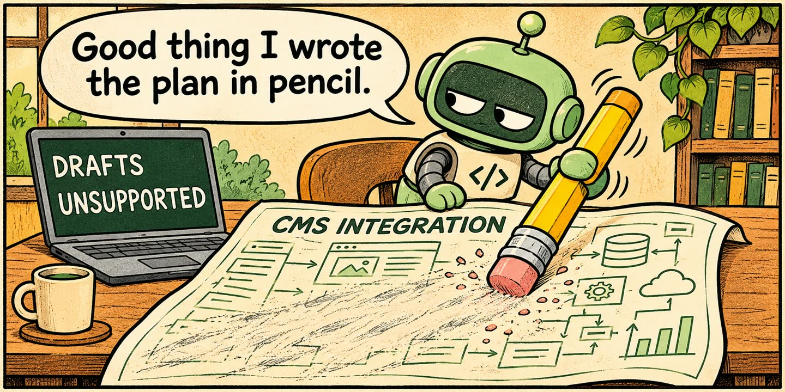

# ProbeStep

ProbeStep is an experimental, open-source debugging skill for Codex and Claude Code. It helps an agent choose the smallest check that could change the next action when a task stalls or a consequential assumption remains untested.

The [ProbeStep notebook](https://probestep.com/) tells [the story behind the skill](https://probestep.com/story/) and reports [the experiments and their limits](https://probestep.com/experiments/).

For example, before building a CMS integration, check whether its API supports the one draft operation the project depends on. When an acceptance test fails despite passing unit tests, compare their conditions and find where the behavior first differs.



**Preview.** Invoke ProbeStep explicitly when the next action depends on a consequential uncertainty. Automatic selection remains experimental.

The earlier Codex pilot tied the baseline on all six cases across three model configurations. Later fixture tests exercised completion evidence, handoffs, and the pause after three discretionary probes. Field benefit on new tasks remains unmeasured. [Evaluation methods and results](docs/evaluation.md)

## Try it in Codex

From the repository root, link the skill into your user skills directory:

```sh
mkdir -p "$HOME/.agents/skills"
ln -s "$PWD/skills/probestep" "$HOME/.agents/skills/probestep"
```

Start a fresh Codex session and invoke `$probestep`.

## Try it in Claude Code

In the project where you want to use ProbeStep, copy the skill from your ProbeStep checkout. Replace `/path/to/probestep` with the checkout path.

```sh
mkdir -p .claude/skills/probestep
cp "/path/to/probestep/skills/probestep/SKILL.md" .claude/skills/probestep/SKILL.md
```

Start a fresh Claude Code session and invoke `/probestep`.

See the [skill source](skills/probestep/SKILL.md) for the workflow, the [evaluation](docs/evaluation.md) for Codex and Claude Code test results, and the [project context](docs/context.md) for current status.

## Credits and license

Created and maintained by [Jared Chu](https://github.com/jaredchu), with development and evaluation contributions from [OpenAI Codex](https://github.com/codex) and Anthropic Claude. See the [commit attribution policy](AGENTS.md#commit-attribution).

Licensed under the [MIT License](LICENSE).
